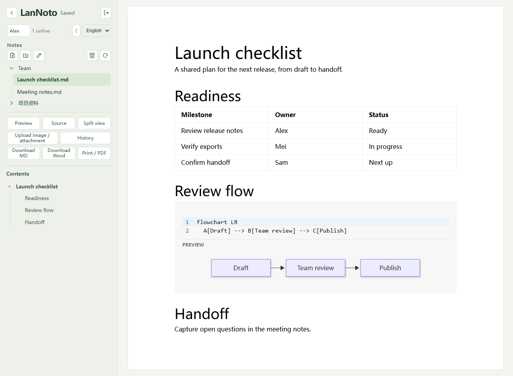

# LanNoto

[简体中文](readme_zh.md)

LanNoto is a self-hosted Markdown workspace for small teams on a local network. Run a single executable or Docker container on one machine, share its address and workspace password, and edit together from your browsers. Notes are saved as plain Markdown files on the host.

[When to use it](#when-to-use-lannoto) · [Install](#install) · [Start LanNoto](#start-lannoto) · [Export and portability](#export-and-portability) · [Develop](#develop-lannoto)



## What you can do

- **Write together.** Edit in a visual editor, work directly with Markdown, or use a split view with a live preview and synchronized scrolling. Click an online collaborator's name to jump to their cursor. Open notes remain editable during a temporary disconnect and sync when the connection returns.
- **Organize your notes.** Create, rename, and move notes and folders in the file tree. Drag the sidebar divider to give the file list more room. The collapsible H1–H5 outline jumps to the corresponding heading, including in source mode.
- **Review changes.** Compare saved versions in a line-by-line diff and restore a version. Press **Ctrl+S** or **Cmd+S** to save and record a version. Large edits and periodic changes can also create checkpoints.
- **Add visuals and share.** Paste or drop images and attachments, render Mermaid diagrams, download Markdown or Word, and print to PDF through your browser. Export the whole workspace as a ZIP when you want to share the notes and assets.
- **Browse attachments.** Preview images, text, and PDFs from the sidebar. Archives ask before downloading. Drag attachments between workspace folders, including `static`.
- **Work on a local network.** The app bundles its interface and rendering assets. It works on a LAN without internet access and offers English, Simplified Chinese, and a dark theme.

## When to use LanNoto

LanNoto is designed for short writing sessions with a small, trusted team on the same network. Start it for a meeting, workshop, or shared draft, then take the Markdown files and attachments with you. The server, editor, and rendering assets ship in a single executable. Running it directly requires no database service, language runtime, or Docker. Docker is optional, and Word export is the only feature that requires Pandoc.

| Tool | Use case and deployment |
| --- | --- |
| **LanNoto** | Temporary LAN writing with a small team. Run one executable and share a workspace password. Notes and attachments are ordinary files on the host. |
| **HackMD** | Hosted collaborative Markdown with team roles and note sharing controls. The hosted service runs the infrastructure for you. [HackMD team documentation](https://hackmd.io/@docs/what-is-team) |
| **ShowDoc** | A structured home for API references and team documentation, with project-level access and membership. Self-hosted installs can use Docker or PHP, and ShowDoc ships with SQLite. [ShowDoc project](https://github.com/star7th/showdoc) · [Deployment and storage](https://github.com/star7th/showdoc/blob/master/documentation/en/Development%26Contribution.md) · [Docker guide](https://github.com/star7th/showdoc/blob/master/documentation/en/ByDocker.md) |
| **HedgeDoc** | A self-hosted collaborative Markdown editor with per-note permissions. Its Docker Compose example includes PostgreSQL, and SQLite is also supported. [HedgeDoc overview](https://hedgedoc.org/) · [Docker guide](https://docs.hedgedoc.org/setup/docker/) · [Database guidance](https://docs.hedgedoc.org/guides/production-ready/#database) |

LanNoto keeps the server footprint small by bundling the frontend and keeping notes, attachments, and history on disk in the workspace. Access is granted at the workspace level. Everyone who signs in with the shared password can edit its notes. For a long-running writing platform, a shared knowledge base, or ongoing per-user and per-document access management, choose a tool with the account and permission model your team needs.

## Install

The release workflow publishes Windows, Linux, and macOS binaries to [GitHub Releases](https://github.com/IanSmith123/LanNoto/releases) and Docker images to GitHub Container Registry (GHCR). You can also [build from source](docs/develop.md#构建).

| OS | Archive suffixes |
| --- | --- |
| Windows | `windows-amd64`, `windows-arm64`, `windows-386` |
| Linux | `linux-amd64`, `linux-arm64`, `linux-386`, `linux-armv7` |
| macOS | `darwin-arm64` (Apple Silicon), `darwin-amd64` (Intel) |

`386` is 32-bit x86. `armv7` is 32-bit ARM.

### Automated installation

With GitHub CLI installed and signed in, run the commands for your platform from the directory where you want to install the executable. [GitHub CLI download reference](https://cli.github.com/manual/gh_release_download)

**Linux x86-64** (use `lannoto-linux-arm64.tar.gz` in both commands on ARM64)

```sh
gh release download --repo IanSmith123/LanNoto --pattern lannoto-linux-amd64.tar.gz
tar -xzf lannoto-linux-amd64.tar.gz
```

**Windows x86-64** (PowerShell)

```powershell
gh release download --repo IanSmith123/LanNoto --pattern lannoto-windows-amd64.tar.gz
tar -xzf lannoto-windows-amd64.tar.gz
```

**macOS Apple Silicon** (use `lannoto-darwin-amd64.tar.gz` on Intel)

```sh
gh release download --repo IanSmith123/LanNoto --pattern lannoto-darwin-arm64.tar.gz
tar -xzf lannoto-darwin-arm64.tar.gz
```

### Manual installation

1. Download `lannoto-<suffix>.tar.gz` for your platform along with `SHA256SUMS` from GitHub Releases.
2. Compare the archive's SHA-256 hash with the matching line in `SHA256SUMS`. Use `sha256sum <archive>` on Linux, `shasum -a 256 <archive>` on macOS, or `Get-FileHash <archive> -Algorithm SHA256` in PowerShell.
3. Extract the executable and README, then follow the startup steps below.

### Docker image

Both images support Linux amd64, ARM64, 386, and ARMv7.

| Image | Tags | Contents |
| --- | --- | --- |
| Standard | `latest`, `<version>` | LanNoto and Pandoc for Word export |
| Slim | `latest-slim`, `<version>-slim` | LanNoto |

The release workflow updates the `latest` tags for the release marked Latest on GitHub. Use a version tag to pin a deployment.

```sh
docker run -d --name lannoto --restart unless-stopped -p 8080:8080 --mount type=volume,source=lannoto-data,target=/workspace ghcr.io/iansmith123/lannoto:latest
docker logs lannoto
```

Open `http://localhost:8080` and use the password printed in the logs. The named volume keeps both `note/` and `.lannoto/` when you replace the container.

## Start LanNoto

1. Open a terminal in the directory where you want to keep your notes. Run `.\lannoto.exe` on Windows or `./lannoto` on Linux and macOS if the executable is there. You can also run it by absolute path. The terminal's current directory determines the workspace.
2. On the host, open `http://localhost:8080`. From another machine on the LAN, open `http://<host-ip>:8080`. Sign in with the shared password printed at startup.
3. Create a note in the sidebar or put existing `.md` files in `note/` and refresh the file list.

Use `--host` and `--port` to change the default listen address `0.0.0.0:8080`, or `--password` to set the shared password. After a temporary disconnect, keep the editor tab open until it shows **Saved** so pending edits can sync.

### Workspace and backups

- `note/` holds Markdown files and subfolders. New uploads go into `note/static/`.
- `.lannoto/` holds version history, collaboration recovery data, and the file-move index.
- For a full backup, wait for edits to save, stop LanNoto, and copy both directories. Use the workspace ZIP when you want to share the current notes and files.

## Export and portability

| Action | Result |
| --- | --- |
| **Download Markdown** | A plain `.md` file, or a ZIP with the note and its directly referenced local files. The ZIP adjusts local paths in the exported copy as needed. |
| **Export workspace ZIP** | The full `note/` tree. History and collaboration state stay in `.lannoto/`. |
| **Download Word** | A `.docx` file. Native installations need Pandoc on the host's PATH or a path supplied with `--pandoc`. Mermaid diagrams are embedded as images. [Pandoc installation guide](https://pandoc.org/installing.html) |
| **Print / PDF** | Choose standard A4, narrow A4, or a continuous page, then use your browser's print dialog to save as PDF. Bookmarks depend on the browser and print destination. |

Standard Markdown images such as `` are portable when the target editor can resolve the path. LanNoto's `` uses a Crepe extension for image sizing. Other editors may display the image at their default size. Use a paragraph beneath the image when the caption needs to be visible across editors. Raw HTML such as `` is kept as text in LanNoto's preview and is rejected by Word export.

## Develop LanNoto

Use Go 1.26.10 or later, Node.js 24 as used by CI, and npm. From the repository root, build the frontend before the Go binary so the executable can embed the frontend assets.

```sh
npm --prefix web ci
npm --prefix web run build
go build -o dist/lannoto ./cmd/lannoto
```

On Windows, use `dist/lannoto.exe` as the output path. Run the built binary from a separate test workspace. Use `go test ./...` for the Go suite and `npm --prefix web test` for browser tests. The Word integration tests require Pandoc. [Development guide](docs/develop.md) · [Project design](design.md) · [Release workflow](.github/workflows/release.yml)

## Acknowledgements

Thanks to the maintainers of the projects LanNoto builds on.

| Area | Projects |
| --- | --- |
| Editing and rendering | Milkdown / Crepe, ProseMirror, CodeMirror, Mermaid, KaTeX |
| Collaboration | Yjs, y-protocols, y-codemirror.next, ygo, coder/websocket |
| Markdown, history, and storage | Goldmark, jsdiff, gofrs/flock, natefinch/atomic, Go x/image and x/sys |
| Build and testing | TypeScript, Vite, Playwright |
| Optional Word export | Pandoc, installed separately for native builds |

[Third-party notices](THIRD_PARTY_NOTICES.md) · [Full license texts](licenses/THIRD_PARTY.txt)
