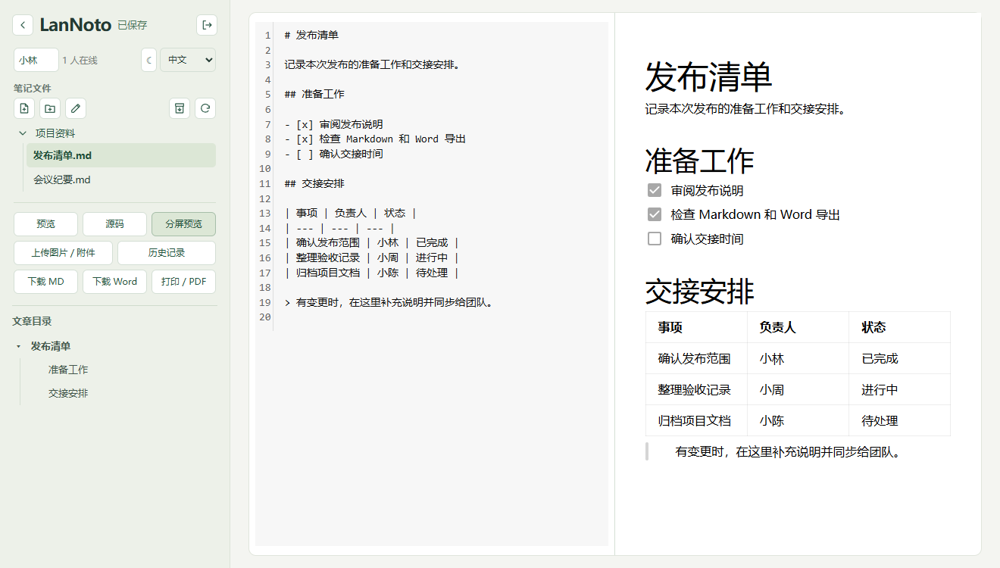

# LanNoto

[English](README.md)

LanNoto 是给小团队用的局域网 Markdown 笔记软件。在一台电脑上运行可执行文件或 Docker 容器，把访问地址和工作区密码分享给团队，大家就能用浏览器一起编辑。笔记以普通 Markdown 文件保存在主机上。

[适用场景与对比](#适用场景与对比) · [安装](#安装) · [启动 LanNoto](#启动-lannoto) · [导出与兼容性](#导出与兼容性) · [继续开发](#继续开发)



## 可以做什么

- **多人一起写。** 支持所见即所得、Markdown 源码和分屏实时预览。分屏时两栏可同步滚动，点击在线成员可跳到对方的光标位置。临时断线时可以继续编辑已打开的笔记，恢复连接后会自动同步。
- **整理笔记。** 在目录树中新建、重命名和拖动笔记或文件夹。拖动侧栏分隔线可扩大文件列表。H1–H5 文章目录支持折叠，在源码模式下也能按标题跳转。
- **查看历史。** 逐行比较版本差异，按需恢复。按 **Ctrl+S** 或 **Cmd+S** 保存当前笔记并留档。大段修改和定时保存也可触发留档。
- **插入图表和分享。** 可粘贴或拖入图片及附件，预览 Mermaid 图表，下载 Markdown 或 Word，也可通过浏览器打印为 PDF。工作区可打包为 ZIP 分享。
- **浏览附件。** 在侧栏预览图片、文本和 PDF，压缩包等文件在确认后下载。附件可以拖入或拖出 `static`，也可以在其他工作区目录之间移动。
- **在内网使用。** 界面和渲染资源随程序打包，纯内网也能运行。界面支持简体中文、英文和夜间模式。

## 适用场景与对比

LanNoto 面向局域网内的小规模、短期协作写作，比如会议纪要、工作坊记录和临时合写草稿。一台电脑启动服务，团队用浏览器加入，写完即可带走 Markdown 和附件。服务端、编辑器和渲染资源打包为一个可执行文件，直接运行无需数据库服务、额外的语言运行时或 Docker。Docker 可选，只有 Word 导出需要 Pandoc。

| 工具 | 适用场景与部署方式 |
| --- | --- |
| **LanNoto** | 小团队临时合写。运行一个可执行文件，分享工作区密码，笔记和附件以普通文件保存在主机上。 |
| **HackMD** | 托管的多人 Markdown 写作，提供团队角色和笔记分享权限。使用托管版时，由平台维护运行环境。 [HackMD 团队文档](https://hackmd.io/@docs/what-is-team) |
| **ShowDoc** | 适合维护 API 文档和团队技术资料，支持按项目管理成员和访问权限。自部署可用 Docker 或 PHP，内置 SQLite。 [ShowDoc 项目](https://github.com/star7th/showdoc) · [运行环境与存储](https://github.com/star7th/showdoc/blob/master/documentation/en/Development%26Contribution.md) · [Docker 部署](https://github.com/star7th/showdoc/blob/master/documentation/en/ByDocker.md) |
| **HedgeDoc** | 自托管的多人 Markdown 编辑器，支持按笔记设置权限。官方 Docker Compose 示例搭配 PostgreSQL，也支持 SQLite。 [HedgeDoc 项目](https://hedgedoc.org/) · [Docker 部署](https://docs.hedgedoc.org/setup/docker/) · [数据库说明](https://docs.hedgedoc.org/guides/production-ready/#database) |

LanNoto 把前端随程序打包，笔记、附件和历史都写入本地工作区，减少了需要常驻的服务和部署开销。权限以工作区为单位，使用同一密码登录的成员都能编辑其中的笔记。长期写作、知识库建设，或需要持续管理成员角色和逐篇权限的团队，更适合使用具备相应账号和权限体系的平台。

## 安装

发布流程会将 Windows、Linux 和 macOS 可执行文件上传到 [GitHub Releases](https://github.com/IanSmith123/LanNoto/releases)，并将 Docker 镜像推到 GitHub Container Registry（GHCR）。也可以[从源码构建](docs/develop.md#构建)。

| 系统 | 压缩包后缀 |
| --- | --- |
| Windows | `windows-amd64`、`windows-arm64`、`windows-386` |
| Linux | `linux-amd64`、`linux-arm64`、`linux-386`、`linux-armv7` |
| macOS | `darwin-arm64`（Apple Silicon）、`darwin-amd64`（Intel） |

`386` 指 32 位 x86，`armv7` 指 32 位 ARM。

### 自动安装

安装并登录 GitHub CLI 后，在希望放置程序的目录执行对应平台的命令，即可下载并解压。[GitHub CLI 下载命令参考](https://cli.github.com/manual/gh_release_download)

**Linux x86-64**（ARM64 机器将两处包名都换成 `lannoto-linux-arm64.tar.gz`）

```sh
gh release download --repo IanSmith123/LanNoto --pattern lannoto-linux-amd64.tar.gz
tar -xzf lannoto-linux-amd64.tar.gz
```

**Windows x86-64**（PowerShell）

```powershell
gh release download --repo IanSmith123/LanNoto --pattern lannoto-windows-amd64.tar.gz
tar -xzf lannoto-windows-amd64.tar.gz
```

**macOS Apple Silicon**（Intel 机器用 `lannoto-darwin-amd64.tar.gz`）

```sh
gh release download --repo IanSmith123/LanNoto --pattern lannoto-darwin-arm64.tar.gz
tar -xzf lannoto-darwin-arm64.tar.gz
```

### 手工安装

1. 在 GitHub Releases 下载对应的 `lannoto-<后缀>.tar.gz` 和 `SHA256SUMS`。
2. 计算压缩包的 SHA-256，与 `SHA256SUMS` 中对应条目比对。Linux 可运行 `sha256sum <压缩包>`，macOS 可运行 `shasum -a 256 <压缩包>`，PowerShell 可运行 `Get-FileHash <压缩包> -Algorithm SHA256`。
3. 解压得到可执行文件和 README，然后按下文启动程序。

### Docker 镜像

两种镜像都支持 Linux amd64、ARM64、386 和 ARMv7。

| 镜像 | 标签 | 包含内容 |
| --- | --- | --- |
| 标准版 | `latest`、`<版本>` | LanNoto 和用于 Word 导出的 Pandoc |
| 精简版 | `latest-slim`、`<版本>-slim` | LanNoto |

发布流程为 GitHub 标记为 Latest 的正式版本更新 `latest` 标签。需要固定部署版本时，使用对应的版本标签。

```sh
docker run -d --name lannoto --restart unless-stopped -p 8080:8080 --mount type=volume,source=lannoto-data,target=/workspace ghcr.io/iansmith123/lannoto:latest
docker logs lannoto
```

打开 `http://localhost:8080`，使用日志中的密码登录。替换容器时继续使用同一个数据卷，即可保留 `note/` 和 `.lannoto/`。

## 启动 LanNoto

1. 在希望存放笔记的目录打开终端。如果程序就在该目录，Windows 运行 `.\lannoto.exe`，Linux 和 macOS 运行 `./lannoto`。也可以通过绝对路径运行程序，工作区由终端当前目录决定。
2. 在主机访问 `http://localhost:8080`。局域网内的成员访问 `http://<主机地址>:8080`，用启动日志里的共享密码登录。
3. 在侧栏新建笔记，或把已有 `.md` 文件放入 `note/` 后刷新文件列表。

默认监听地址为 `0.0.0.0:8080`。可用 `--host` 和 `--port` 调整监听地址或端口，用 `--password` 指定共享密码。临时断线后，请保留编辑标签页，等待状态恢复为「已保存」。

### 工作区与备份

- `note/` 保存 Markdown 文件和子文件夹。新上传的图片和附件进入 `note/static/`。
- `.lannoto/` 保存历史版本、协作恢复数据和文件移动索引。
- 完整备份时，等编辑保存后停止程序，再复制这两个目录。分享当前笔记和附件时，可以使用工作区 ZIP。

## 导出与兼容性

| 操作 | 结果 |
| --- | --- |
| **下载 Markdown** | 直接下载 `.md`，或把笔记及其直接引用的本地资源打包为 ZIP。导出副本会按需调整本地路径。 |
| **打包导出工作区** | 打包整个 `note/` 目录。历史版本和协作状态保存在 `.lannoto/`。 |
| **下载 Word** | 导出 `.docx`，Mermaid 图表嵌入为图片。直接运行可执行文件时，需在主机安装 Pandoc 并加入 PATH，或通过 `--pandoc` 指定路径。 [Pandoc 安装说明](https://pandoc.org/installing.html) |
| **打印 / PDF** | 选择正常 A4、窄边距 A4 或连续长页，再通过浏览器打印窗口保存为 PDF。书签由浏览器和打印目标决定。 |

标准图片写法 `` 可在能解析该路径的其他编辑器中使用。`` 的缩放来自 Crepe 扩展，其他编辑器可能按默认尺寸显示。需要跨编辑器显示图注时，可以在图片下另写一段。原始 HTML 标签如 `` 在 LanNoto 预览中保留为文本，Word 导出会拒绝这类标签。

## 继续开发

准备 Go 1.26.10 或更新版本、CI 使用的 Node.js 24 和 npm。从仓库根目录先构建前端，再生成内嵌前端资源的 Go 程序。

```sh
npm --prefix web ci
npm --prefix web run build
go build -o dist/lannoto ./cmd/lannoto
```

在 Windows 上把输出路径改为 `dist/lannoto.exe`。构建后在独立的测试工作区启动。Go 测试使用 `go test ./...`，浏览器测试使用 `npm --prefix web test`。Word 集成测试需要 Pandoc。 [开发文档](docs/develop.md) · [项目设计](design.md) · [发布工作流](.github/workflows/release.yml)

## 致谢

感谢 LanNoto 所用开源项目的维护者。

| 用途 | 项目 |
| --- | --- |
| 编辑与渲染 | Milkdown / Crepe、ProseMirror、CodeMirror、Mermaid、KaTeX |
| 实时协作 | Yjs、y-protocols、y-codemirror.next、ygo、coder/websocket |
| Markdown、历史与存储 | Goldmark、jsdiff、gofrs/flock、natefinch/atomic、Go x/image 和 x/sys |
| 构建与测试 | TypeScript、Vite、Playwright |
| 可选的 Word 导出 | Pandoc，可执行文件部署时单独安装 |

[第三方声明](THIRD_PARTY_NOTICES.md) · [完整许可证文本](licenses/THIRD_PARTY.txt)
